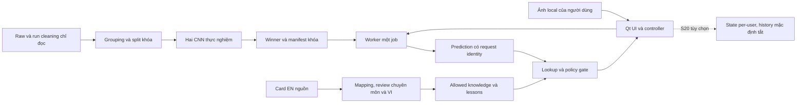

# Công nghệ, module và hợp đồng triển khai

Ngày 14/10/2026. Companion của [kế hoạch phase](app-development-plan.md), dẫn xuất từ [spec](../spec-tomato-desktop/spec-tomato-desktop.md) và AD-1…AD-8. Đây là thiết kế triển khai dự kiến, chưa có file sản phẩm hoặc dependency mới được cài.

**Checkpoint 15/10/2026:** Mô tả chưa triển khai ở trên là baseline planning. Phase 0 đã kiểm CPU/Qt/frozen spawn và chọn EfficientNet-B0; phiên bản thật ở [compatibility](../../../docs/development/compatibility.json). S02/S03 và S10 có code preparation. [S11 một phần](../../../artifacts/phase2/s11/README.md) thêm `scripts/knowledge/publish.py` với interface `publish_knowledge(draft: CardDraft, approvals: Path) -> KnowledgeBundle`: response chuẩn bị chỉ có `needs_check`, mã chặn và nội dung rỗng. Đây chưa phải runtime/release KnowledgeBundle trong bảng thiết kế. Không import publisher/curator vào app; S06 chỉ nhận bundle allowed sau hồ sơ thật và positive publisher/lookup đã kiểm. Không có app sản phẩm hoặc training checkpoint.

## Công nghệ và lý do

| Thành phần | Công nghệ định hướng | Công việc phải kiểm/chốt | Không tự thêm |
| --- | --- | --- | --- |
| Desktop | Python, PySide6 Widgets | Wheel Windows, DPI/accessibility, lifecycle, license Qt và module thực dùng | React/Electron/web server |
| Thực nghiệm và suy luận | PyTorch + torchvision; EfficientNet-B0/ResNet50 | Baseline CPU đã kiểm ở Phase 0; CUDA train, weights hash/rights và pilot còn pending | CNN thứ ba, ensemble hoặc ONNX export |
| Ảnh | Pillow hiện có trong pipeline | Pin bản vá phù hợp; decode/EXIF/RGB/size và bomb protection | Upload, OCR, segmentation |
| Contracts | `dataclasses`, `enum`, `json`, `hashlib`, `pathlib` | Typed fields, schema version, rejection mã rõ; không ép kiểu boolean/string thành số | Framework validation hoặc ORM khi stdlib đủ |
| Worker | `multiprocessing` + IPC nội bộ có giới hạn; Qt signal/timer chỉ điều phối UI | Windows spawn, hủy/restart, số worker, heartbeat và packaging | Broker/microservice hoặc API local mở cổng |
| Tri thức/bài học | JSON UTF-8, bundle dẫn xuất được kiểm | Mapping/claim/source/VI/version/gate, quiz key | LLM, vector DB, dịch runtime |
| State | JSON atomic cho preferences; `sqlite3` chỉ khi S20 được duyệt | Per-user app directory, schema migrate/backup nếu cần, retention | DB server, account/password store |
| Test native | `unittest`, `PySide6.QtTest`; Qt event loop và native process smoke | Fixture chính xác, Qt widgets/windows; automation ngoài process chỉ sau spike | Dùng Playwright để tuyên bố đã test app Qt |
| Thực nghiệm số | Dependency đã cần bởi torch; NumPy cho seed/arrays; metrics bằng thư viện đã có hoặc code nhỏ đã kiểm | Quyết định có cần scikit-learn/matplotlib trong môi trường train; ghi lý do/version | Đưa notebook/plotting/train stack vào runtime |
| Build/đóng gói | `uv`, lock/environment riêng, PyInstaller `onedir` | Hook Qt/torch, CPU wheels, freeze_support, Windows sạch, notices | Installer phức tạp, auto-update trước nhu cầu |

Phase 0 tạo ma trận phiên bản **thực chạy**, không dùng số phiên bản tài liệu web làm lockfile. Python 3.12 hiện dùng cho một số cleaning run là ứng viên, không là lựa chọn bắt buộc; Python 3.14.5 dùng audit cũng không chứng minh stack app tương thích. Chuẩn bị/cài đặt sau này cần quyền giai đoạn tương ứng. Tách lock train và app; giữ compatibility contract để checkpoint đọc được bởi runtime.

## Đường đi dữ liệu và ranh giới

Training không gọi UI. Runtime không import cleaning script hoặc đọc raw. Worker không nhận lệnh Python/model path tùy ý từ người dùng. Pipeline tạo bundle curated; app chỉ đọc tài nguyên đã đóng gói. SHA-256 phát hiện hỏng/ghép sai trong baseline tin cậy, không xác thực người duyệt hay chống kẻ thay cả executable/manifest.

## File map tối thiểu để triển khai

Các path dưới đây **dự kiến tạo**, không phải module đã tồn tại. Root Python package đề xuất `tomatoai/`, tránh dựng lại web `frontend/` trống. Điều chỉnh tên nhỏ khi thực hiện vẫn phải cập nhật interfaces trong kế hoạch.

| File/module | Trách nhiệm | Story sở hữu |
| --- | --- | --- |
| `pyproject.toml`, locks train/app, `docs/development/decisions.md` | Môi trường, run command, quyết định C0…C5 và phiên bản; chuẩn bị theo milestone cần dùng | S01/S05/S06/S18 |
| `scripts/data/prepare_benchmark.py`, `tests/data/test_benchmark.py` | Tiêu thụ registry/manifest, grouping resolution/split derivative; không cleaning lại toàn bộ | S02–S04 |
| `tomatoai/contracts.py` | Kiểu manifest/request/result, enum/status/limits và validators; một nguồn contract | S05/S06/S14 |
| `tomatoai/preprocessing.py` | Eval preprocessing được version/hash, training eval và app dùng chung | S05/S06 |
| `scripts/experiments/run.py`, `select.py`, `evaluate.py`, `configs/*.json` | Train harness, chọn validation, final metrics; S07/S08 dùng chung harness với hai config | S05/S07–S09/S15/S16 |
| `scripts/knowledge/curate.py`, `content/*.json` | Chọn/biên tập EN–VI/claim/lesson nguồn, sinh bundle version mới | S10/S11/S10b/S11b/S12 |
| `tomatoai/bundle.py` | Nạp release manifest và kiểm version/hash/class/shape/rights scope; không download | S06/S14/S18 |
| `tomatoai/inference.py` | Decode/preprocess/model forward/decision policy; không knowledge | S06/S09/S14 |
| `tomatoai/worker.py` | Worker lifecycle, bounded IPC, cancel/restart; không GUI trong process con | S06/S14 |
| `tomatoai/knowledge.py`, `tomatoai/lessons.py` | Exact lookup và review/context gate; lesson/quiz theo reviewed key | S06/S10–S12 |
| `tomatoai/controller.py`, `tomatoai/ui.py` | State machine/request identity, Qt màn hình, sources/errors/accessibility | S06/S13/S14 |
| `tomatoai/__main__.py` | Entrypoint, freeze_support, spawn, khởi động tối thiểu, không tự train | S06/S18 |
| `tomatoai/state.py` | Preferences ít dữ liệu; history/profile chỉ mở thêm khi duyệt S20 | S13/S20 |
| `packaging/tomatoai.spec`, `resources/release-manifest.json` | Reproducible bundle, quyền asset, notices, resource paths | S18 |
| `tests/contracts/`, `tests/native/`, `tests/security/`, `tests/knowledge/` | Unit/integration/native assertions đúng T01…T20 liên quan | Story thay hành vi tương ứng |
| `artifacts/<run-or-release>/` | Model/metrics/review/QA evidence; không chứa API key hoặc dữ liệu người dùng mặc định | Từng story |

Không tạo tất cả folder ở Phase 0. Chỉ tạo file khi có deliverable cần nó. Tái dùng cleaning manifests, helper có sẵn và contract review; không import `scripts/data/review_integration.py` vào executable vì nó phụ thuộc module cleaning. Tách/đưa phần lookup thuần sang `tomatoai/knowledge.py` khi S06 cần, giữ adapter kiểm tra cũ và 22 regression tests; không nhân đôi logic rồi để hai gate lệch nhau.

## Hợp đồng dùng chung và interfaces

Trong `tomatoai/contracts.py`, khai báo các dataclass/enum sau. Mỗi artifact có `schema_version`; JSON parse từ chối key trùng và số NaN/Infinity trước dùng. Số nguyên không nhận `bool`; thời gian/limit phải hữu hạn và dương, không dùng 0/-1 làm vô hạn.

| Type | Field và invariant cần khóa |
| --- | --- |
| `LabelManifest` | `schema_version`, `version`, `sha256`, `ordered_codes`, `raw_labels`, `knowledge_ids`; approved scope 10 code duy nhất, không tự lexical-sort class order |
| `ImageLimits` | `max_bytes`, `max_pixels`, `max_long_edge`, `min_short_edge`; cấu hình được duyệt và validate, boundary inclusive rõ |
| `RuntimeLimits` | `thread_budget`, `job_timeout_s`, `cancel_grace_s`; `active=1`, `queued=0`; timeout cold load tách job timeout |
| `PreprocessSpec` | `version`, `sha256`, `resize`, `crop`, `interpolation`, `mean`, `std`, `input_size`; lấy từ recipe đã pin, eval và app dùng cùng implementation |
| `ModelManifest` | `model_id`, `architecture`, `variant`, `checkpoint_sha256`, `class_manifest_sha256`, `preprocess`, `split_sha256`, `selection_sha256`, `policy_version`, `framework_versions`; không tự đổi shape/order để nạp |
| `PredictionRequest` | `schema_version`, `request_id`, `image_identity`, `image_path`, `model_version`; chỉ nội bộ worker, không persist path đầy đủ |
| `PredictionResult` | `request_id`, `image_identity`, `status`, `status_code`, `score_vector`, `reason`, `model_version`, `preprocess_version`, `policy_version`, `timing`; không accepted thì code dùng advice là null |
| `ReviewPolicy` | `version`, `mode`, `allowed_scope`, `approval_evidence`; mode đang chặn cho tới C3. Không có `skip_review`/`allow_unreviewed=true` |
| `KnowledgeBundle` | `version`, `sha256`, class/mapping/claim/EN/VI/glossary/lesson metadata; chỉ bundle curated, hashes bind đúng nguồn và reviewer |
| `GuidanceResult` | `status` trong `allowed/needs_check/knowledge_unavailable`, `reason`, `condition_id`, `claims`, `sources`, `lesson_ids`; blocked thì `claims=[]` |
| `QuizAnswerResult` | `lesson_id`, `question_id`, `correct`, `explanation`, `source_ids`; confidence ảnh không tham gia chấm |
| `HistoryEntry` | Chỉ S20: UUID/thời gian/status/code/model/KB/policy version; không ảnh/path/EXIF mặc định, không diagnosis-confirmed field |

Các kiểu hỗ trợ cũng phải được định nghĩa, không để task sau tự đặt tên khác:

| Type / nơi định nghĩa | Field chính và giới hạn |
| --- | --- |
| `RuntimeBundle`, `Preferences` — `tomatoai/contracts.py` | Bundle chứa `model_manifest`, `labels`, `knowledge`, `policy`; preferences chỉ `schema_version`, `text_scale`, `show_help`, `history_enabled=False`, optional `profile_display_name`, không security toggles |
| `ValidatedImage`, `CancelSignal` — `tomatoai/contracts.py` | Image chứa `image_identity`, `format`, `width`, `height`, normalized pixels trong RAM; cancel wrap event nội bộ và `.is_cancelled() -> bool`, không deserialize callable từ người dùng |
| `InventoryReport`, `GroupReview`, `SplitPolicy`, `SplitManifest` — `scripts/data/prepare_benchmark.py` | Inventory có selected runs/counts/provenance/errors; group review có components/dispositions/unresolved/decision references; split policy có seed/ratios/rule/scope; manifest có ordered codes/group/component assignments/supports/exclusions/hash |
| `CardDraft` — `scripts/knowledge/curate.py` | card ID, raw/source hashes, claims/EN–VI/terms/context/review/lesson draft; không mặc định approved |
| `RunArtifacts` — `scripts/experiments/run.py` | run/model/config/split/preprocess/checkpoint hashes, seed/device/budget/train–val logs/metric paths; không tự dùng test |
| `SelectionRule`, `SelectionRecord`, `DecisionPolicy` — `tomatoai/contracts.py` | rule xác định metric/targets/tie-break/budget; record pins winner/config/versions/time; policy ghi thresholds/margins/quality/source/approval và rejection behavior, không tự lấy giá trị fixture |
| `EvaluationReport` — `scripts/experiments/evaluate.py` | ordered labels/support/metrics/rejections/performance/evidence gaps/selection hash; tính toán không mutate selection |

`artifacts/<run-or-release>/` dùng path configurable ngoài raw; paths/CLI chỉ nhận config/manifest thuộc scope được phép. Các dataclass dữ liệu train/data ở module sở hữu; runtime không import các module này. `RunArtifacts` qua boundary là manifest JSON versioned, không pickle object.

| Interface sản phẩm dự kiến | Owner / yêu cầu |
| --- | --- |
| `load_bundle(root: Path) -> RuntimeBundle` | `bundle.py`; read-only, fail closed; `RuntimeBundle` chứa model manifest, labels, knowledge và policy đã kiểm |
| `preprocess(image: PIL.Image.Image, spec: PreprocessSpec) -> torch.Tensor` | `preprocessing.py`; FP32 batch tensor, normalize đúng recipe, không mutate ảnh gốc |
| `validate_image(path: Path, limits: ImageLimits) -> ValidatedImage` | `inference.py`; decode trong worker, bounded bytes/pixels, tạo identity của byte đã dùng, không TOCTOU giữa preview và infer |
| `predict(request: PredictionRequest, bundle: RuntimeBundle, cancel: CancelSignal) -> PredictionResult` | `inference.py`; `CancelSignal` wrapper của event nội bộ; `ValidatedImage` immutable metadata/pixels không persist |
| `WorkerManager.start(request: PredictionRequest) -> None`, `.cancel(request_id: str) -> None`, `.close() -> None` | `worker.py`; kết quả qua signal/message typed, job thứ hai bị từ chối, cleanup process của app |
| `AppController.select_image(path: Path) -> None`, `.run() -> None`, `.cancel() -> None`, `.receive(result: PredictionResult) -> None` | `controller.py`; stale identity không render hoặc lookup; state machine là nguồn enabled/disabled controls |
| `lookup_guidance(bundle: KnowledgeBundle, prediction: PredictionResult, context: dict[str, str], policy: ReviewPolicy) -> GuidanceResult` | `knowledge.py`; đúng condition/version/review; không đoán context, không ghép top-k |
| `answer_question(lesson_id: str, question_id: str, option_id: str) -> QuizAnswerResult` | `lessons.py`; dùng key đã review, không random/sinh đáp án; option không tồn tại bị lỗi typed |
| `load_preferences(root: Path) -> Preferences`, `save_preferences(root: Path, value: Preferences) -> None` | `state.py`; root dùng đường per-user chuẩn, write atomic; preference lỗi không vô hiệu security gate |
| `record_history(entry: HistoryEntry) -> None`, `delete_history(ids: list[str]) -> int` | Chỉ S20; storage tắt thì zero writes, xóa ID parameterized trong DB, không file ảnh nguồn |

## Tham số đề xuất và cách khóa

Kế thừa đề xuất C1, **chưa phải acceptance người dùng đã duyệt**: 20 MiB/file, 24 megapixel, cạnh dài ≤12.000 px, cạnh ngắn ≥64 px; grace hủy 2 s; job watchdog 15 s; CPU threads khởi điểm 2; warm end-to-end p95 ≤3 s, peak RSS ≤2 GB, bundle ≤1,5 GB. Image geometry dùng EXIF orientation chuẩn hóa với policy đã test. S01 ghi target/limits, S05 pilot, S14 test boundary và timeout cold riêng; nếu sửa cần quyết định trước nghiệm thu, không nới hồi tố.

Eval input 224×224 là đề xuất từ recipe hai model; recipe resize/crop/interpolation/normalization có thể khác. Không ép cùng transform nếu weights recipe khác: giữ cùng split/budget, so sánh công bằng theo protocol đã duyệt. Threshold 0,7 trong lookup fixture là dữ liệu test lịch sử, không threshold production. Parity tolerance `atol=rtol=1e-5` CPU FP32 cùng version là đề xuất phải pin bằng golden fixture, không dùng để che sai preprocess.

## Tài liệu công nghệ đã đối chiếu

Tra tài liệu chính thức ngày 14/10/2026 để đặt việc kiểm tương thích, không cài package hoặc chọn newest tự động:

- Torchvision gắn pretrained weights với preprocessing riêng; ghi weights enum và dùng recipe đã pin. [Models and pre-trained weights](https://docs.pytorch.org/vision/stable/models.html).
- PyTorch có loader restricted `weights_only`; không xem nó là sandbox hoặc quyền nạp checkpoint không tin cậy. Cần rà security advisory phiên bản khóa, giới hạn artifact và nguồn first-party. [Serialization semantics](https://docs.pytorch.org/docs/stable/notes/serialization), [PyTorch security policy](https://github.com/pytorch/pytorch/security/policy).
- PyInstaller cần xử lý `multiprocessing.freeze_support()` khi executable dùng multiprocessing; đưa packaging spawn smoke vào S06 và xác nhận ở S18. [Common issues and pitfalls](https://pyinstaller.org/en/stable/common-issues-and-pitfalls.html).
- Qt cung cấp `QStandardPaths` cho đường config/data người dùng; không hardcode thư mục máy này. [QStandardPaths](https://doc.qt.io/qtforpython-6/PySide6/QtCore/QStandardPaths.html).
- Chốt wheel/Python/CPU-CUDA compatibility bằng kiểm thực tế trên Windows. [PyTorch installation](https://pytorch.org/get-started/locally/), [Qt for Python getting started](https://doc.qt.io/qtforpython-6/gettingstarted.html).
