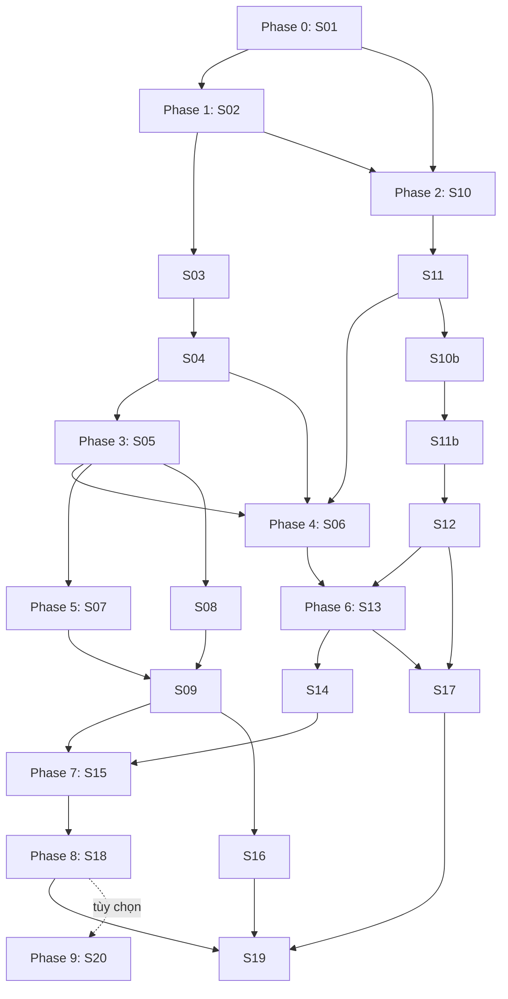

# Kế hoạch phát triển app cà chua theo phase

> **For agentic workers:** REQUIRED SUB-SKILL: Use `superpowers:executing-plans` for native execution, or `superpowers:subagent-driven-development` only when delegation is authorized. Steps use checkbox syntax. Phases 0 and 1 have execution checkpoints below; product implementation and training have not started.

**Goal:** Xây app Windows tiếng Việt offline nhận diện trạng thái lá cà chua bằng model sinh viên huấn luyện, tra hướng dẫn trồng/chăm sóc có nguồn được phép và hỗ trợ học tập.

**Architecture:** Pipeline dữ liệu và thực nghiệm tách app; hai CNN dùng cùng benchmark, app đóng gói winner đã chọn bằng validation. Qt GUI điều phối một worker, tra tri thức theo mã trạng thái và review/context gate; không server hoặc đăng nhập.

**Tech Stack:** Python, PySide6 Widgets, PyTorch/torchvision, Pillow, stdlib JSON/hashlib/pathlib/multiprocessing; PyInstaller onedir. SQLite chỉ khi duyệt history. Người dùng chọn hướng stack này ngày 14/10/2026; phiên bản/compatibility khóa ở Phase 0.

**Spec:** [SPEC-tomato-desktop](../spec-tomato-desktop/spec-tomato-desktop.md), [data readiness](../spec-tomato-desktop/data-readiness.md), [24 yêu cầu và 22 story](../spec-tomato-desktop/requirements-traceability.md). Đọc cả [engineering-contracts](engineering-contracts.md) và [ux-security](ux-security.md).

**Checkpoint thực hiện 15/10/2026:** Người dùng cho phép Phase 0/EPA.S01; xem [decisions](../../../docs/development/decisions.md), [rights ledger](../../../docs/development/assets-rights.json), [compatibility](../../../docs/development/compatibility.json) và [evidence](../../../artifacts/S01/). Nhóm có ba người làm mỗi tối, bảo vệ khoảng hai tháng nữa; chưa ngày/rubric/giờ/compute budget cụ thể, chưa chuyên gia cà chua. Mọi mô tả “chưa bắt đầu” và giả định một sinh viên bên dưới là baseline planning ngày 14/10; checkpoint này thay hiện trạng S01, không tuyên bố các phase sau đã chạy. Năm đầu việc Phase 0 đã có evidence; source/frozen regression 2/2 pass, build cần PATH cô lập và hai stable extension của torchvision. Xem báo cáo S01 để phân biệt hoàn tất kỹ thuật với quyền train/release.

## Global Constraints

- Tên đã chốt: “Ứng dụng thẩm định và nhận diện dịch bệnh cho giống cây cà chua”. Giữ CAP-1…CAP-9, FR01…FR14, NFR01…NFR10, AD-1…AD-8, S01…S20, S10b/S11b, T01…T20.
- Windows desktop tiếng Việt, offline sau cài; không website, AI API hoặc translation API; không tải weights/font/tri thức khi chạy.
- Người dùng chọn dùng trực tiếp không đăng nhập; hồ sơ và lịch sử local tùy chọn, default history off, không là dependency core.
- EfficientNet-B0 và ResNet50 là hai kiến trúc thực nghiệm; B0 được chốt làm baseline tại Phase 0, chưa có winner. Chỉ winner validation được đóng gói; không CNN thứ ba/ensemble mặc định.
- Không tối ưu năng suất/nước/phân bón/chi phí. WUR/Dryad/Mendeley và UC-IPM là research-only ngoài MVP.
- Raw, processed đã chốt, seal, nguồn EN và ID bất biến; thay đổi ở derivative version mới. Không cleaning lại toàn corpus nếu không có delta/lỗi có bằng chứng.
- Group/duplicate split trước augmentation; unresolved không split random. Fit train, chọn model/threshold/config bằng validation, final test sau lock.
- CNN chỉ phân loại; guidance/VI/lesson theo nguồn và gate riêng. Thiếu review/context/version/rights phải chặn; không expert giả hoặc thuốc/liều thiếu căn cứ.
- Một ảnh/job, một worker active, zero queued; GUI không decode/forward nặng. Hủy/đổi ảnh vô hiệu kết quả cũ.
- Các targets/limits/phiên bản chưa chốt được đánh dấu đề xuất. Phê duyệt lập kế hoạch không phải quyền code, tải, dịch hàng loạt hoặc train ngay.

## Review Focus

1. File bị thay sau preview hoặc kết quả đến sau cancel: đúng image identity, zero stale render; S06/S14, T01/T10.
2. Cold load và worker spawn trong gói Windows: không mở app/process vô hạn, không áp timeout warm sai; S06/S18, T10–T13.
3. Input/config null/bool/NaN/zero hoặc malformed manifest: fail closed, không healthy fallback/bypass review; S14, T02–T04/T06/T12.
4. Ảnh accepted nhưng card/VI/claim chưa duyệt hoặc đổi nguồn: guidance trống có lý do, không substitute gần tên; S11/S11b/S13, T07–T09.
5. Full disk/read-only/path tiếng Việt/DPI cao: lỗi hữu ích, không mất input, không cắt hướng dẫn hoặc phá privacy; S13/S14/S18/S20, T18/T19.

## Trạng thái đầu vào và quyết định đã chốt

Kế hoạch chính thức `pi-20261014-v1` có 6 epic/22 story planned. Registry chọn đúng năm cleaning run; review tích hợp có 9 identity source-checked/1 mosaic pending, 17 card/172 claim chưa mở guidance thật. PlantVillage có 18.146 ảnh retained, 11.411 ứng viên kỹ thuật và 6.735 retained review; **chưa approved split/train-ready**. UC-IPM có checkpoint HTTP 403, zero cleaned documents. Không có app native/model sinh viên/benchmark sản phẩm hiện tại.

Hai xác nhận mới của người dùng: không đăng nhập; lập kế hoạch theo Python/PySide6/PyTorch, kiểm tương thích/chốt version ở Phase 0. Người dùng nhắc phải có train mô hình nhận diện và hướng dẫn trồng thích hợp: Phases 3/5 train hai CNN, Phases 2/5 xây tri thức/context/VI, Phase 4 nối thành app. Không chuyển kho tri thức 17 card thành supervised advice training dataset vì chưa có nhãn outcome phù hợp.

## Phase và thứ tự xây

Phase là nhóm công việc để đọc/thực hiện; **không tạo epic/story ID mới hoặc thay graph BMAD**. Bắt đầu một task theo prerequisite của chính task, không đợi mọi task trong phase trước hoàn tất. Hai nhánh dữ liệu/model và tri thức có thể tiến hành độc lập khi có quyền, không hàm ý chạy nhiều agent.

| Phase | Đầu ra | Story | Prerequisite/gate |
| --- | --- | --- | --- |
| **0. Quyết định, quyền, kỹ thuật** | Decision/rights ledger, stack compatibility, targets và scope | S01 | Entry EPA.S01; C0/C1/C3/C5 được giải hoặc ghi blocker thật |
| **1. Benchmark dữ liệu** | Data card/provenance, grouping, approved split/class manifest | S02/S03/S04 | S01 → S02 → S03 → S04; C2 trước full train |
| **2. Tri thức đầu và lời khuyên** | Một card EN–VI/lesson được phép, policy/context contract | S10/S11 | S10 sau S01/S02; S11 sau S10, C3 gate; không đợi mọi ảnh |
| **3. Pilot và train head** | Harness, head checkpoints hai CNN, golden oracle | S05 | S04 và C1/rights/budget/quyền train |
| **4. App lát cắt đầu** | Một ảnh–checkpoint sinh viên–một card VI chạy native | S06 | S04/S05/S11; một card thật được phép và quyền code |
| **5. Model/tri thức/học tập đầy đủ** | Fine-tune hai CNN, validation lock; scope content còn lại và lessons | S07/S08/S09/S10b/S11b/S12 | Model branch sau S05; content branch sau S11; không bắt buộc đợi S06 |
| **6. UI hoàn chỉnh và bảo mật** | Native states/keyboard/DPI, bounded runtime và privacy | S13/S14 | S13 sau S06/S12; S14 sau S13 |
| **7. Kiểm định cuối** | Final metrics/performance, external/care/learning evidence hoặc thiếu chứng cứ | S15/S16/S17 | S15 sau S09/S14; S16 sau S09; S17 sau S12/S13 |
| **8. Đóng gói và bảo vệ** | Windows offline bundle, notices, report/demo | S18/S19 | S18 sau S15 và C5; S19 sau S18/S16/S17 |
| **9. Tiện ích tùy chọn** | History/profile local nếu duyệt và còn budget | S20 | S18; không chặn S19, không tự mở rộng thành tài khoản |

## Cách đọc task và kiểm chứng

File map/interfaces đầy đủ ở [contracts](engineering-contracts.md); màn hình/tính năng/bảo mật ở [UX/security](ux-security.md). File sản phẩm/test dưới đây **chưa tồn tại**; commands là lệnh cần chạy sau implementation bằng interpreter/lock đã chốt. Không gọi chúng là test đã pass ở lượt lập kế hoạch.

Task code theo chu kỳ: viết fixture/assertion cần có → chạy thấy fail do hành vi chưa có → viết tối thiểu → chạy unit/integration/native liên quan → ghi evidence và checkpoint. Task dữ liệu/review/document không tạo unit test sao chép tài liệu; dùng hash/schema/source/decision checks có ý nghĩa. Khi có Git đã được thiết lập, commit phạm vi task; hiện repo chưa có `.git`, nên không tự init hoặc giả commit, dùng snapshot/manifest/checkpoint.

Mỗi task đóng cùng `artifacts/<story-or-run>/checks.json`: command/interpreter/version/input hash, exit code, pass/fail/blocked, report/trace và giới hạn. Một task có source questions unresolved chỉ đóng khi AC cho phép blocker report; không gọi report thiếu evidence là model/content đã được xác nhận.

## Phase 0 — Chốt nền tảng, phạm vi và quyền

### S01 — Decision/rights ledger và kiểm tương thích

**Consumes:** official spec/readiness, package docs, hai quyết định tài khoản/stack. **Produces:** `docs/development/decisions.md`, `assets-rights.json`, `compatibility.json` dùng ở S05/S06/S18. Công nghệ: Python/uv và smoke checks từng package trong environment riêng; không Git/server auth scaffold.

- [x] Ghi C0 rubric/deadline/giờ/team và phạm vi “thẩm định”; unknown giữ owner/ngày hoặc điều kiện quay lại. Không dùng giả định hai giờ mỗi tối thành lịch đã cam kết.
- [x] Khóa quyết định dùng trực tiếp, không accounts/password/backend; profile/history ngoài core. Ghi AD-1 hướng Python/PySide6/PyTorch đã chọn cho planning; pin versions sau compatibility; B0 đã chọn baseline, quyền weights/targets/budget còn pending.
- [x] Lập ma trận Python/torch/torchvision/PySide6/Pillow/PyInstaller/Windows; smoke import, one CPU forward, Qt window/event loop và worker spawn executable nhỏ sau quyền chuẩn bị. Ghi exit/version; không nâng runtime cleaning.
- [x] Ledger source/revision/license/use/redistribution/attribution cho dataset, weights, Qt/deps và từng content asset; reviewer source_checked khác expert approval. C3 chốt policy mode/version/claim scope hoặc giữ blocked.
- [x] Trace một grouped record và một missing-group record từ manifest qua source/hash/rights tới eligibility/refusal. Kiểm `technical_grouping_candidate_grouped != technical_grouping_candidate_missing`; cả hai `training_eligible=False` khi rights/split/review chưa đủ. Đây là quyết định Phase 0 để không giả approved. Target performance/limits ở contracts là đề xuất cần quyết định trước acceptance.

**Gate:** Có decision hoặc blocker thật cho C0/C1/C3/C5; S05 không bắt đầu train nếu C1/rights/quyền train thiếu. S01 không tự giải C2 hoặc biến planning approval thành quyền execution. Test/evidence: T20, tracer/compatibility/rights ledger; không fixture model giả.

## Phase 1 — Chuẩn bị benchmark đủ căn cứ

**Checkpoint 15/10/2026:** S02/S03 đã built sau final review và fix pass, chưa tự done; xem [báo cáo Phase 1](../../../artifacts/phase1/README.md). 18.362 file raw trong năm baseline được rehash, 216 file registry/tickets/reports/cleaning-source giữ nguyên. S04 có harness và tests synthetic, nhưng gate C2/rights vẫn **blocked**: chưa assignments/class manifest sản phẩm, không train. Seed 42, targets 70/15/15 và order/code hiện có chỉ nằm trong pending policy. Full 10 lớp chưa grouping đủ; người dùng cho phép best-effort không tạo expert approval. Checkbox S04 chưa tích vẫn chưa hoàn tất.

### S02 — Tiếp nhận inventory/provenance và delta

**Files:** `scripts/data/prepare_benchmark.py`, `tests/data/test_benchmark.py`, `artifacts/data-card.json`. **Consumes:** registry/current_run, cleaning summary/manifest/queues; **Produces:** `build_inventory(registry_path: Path) -> InventoryReport` với selected runs/counts/rights/blockers. Công nghệ: Python stdlib và helper hiện có nếu phù hợp.

- [x] Fixture registry/run sai hoặc file thiếu; assert `report.errors` chỉ đúng artifact và không tự chọn run mới theo mtime. Chạy test fail trước bổ sung handler.
- [x] Tiếp nhận năm cleaning run, phân biệt source/retained/excluded/review; giữ research-only ba bộ canh tác và UC-IPM blocked. Không gom tất cả thành một training table.
- [x] Đối chiếu hashes thuộc scope baseline, tạo data card/record provenance/inclusion reason; fresh raw rehash chỉ khi cần và ghi scope, không suy từ old seal.
- [x] Chạy `python -m unittest discover -s tests/data -p test_benchmark.py -v` và kiểm `selected_run == registry.current_run`, `raw_writes == 0`, missing provenance rejected. Ghi T15/T18 evidence và delta cụ thể.

**Gate:** Registry/run/provenance/quyền rõ; nhãn chưa chuyên môn xác minh được giữ trong limits, không coi hash là label review.

### S03 — Giải grouping, duplicate và nhãn còn treo

**Consumes:** S02/queues, leaf metadata và bằng chứng nguồn; **Produces:** `resolve_groups(inventory: InventoryReport, decisions: Path) -> GroupReview` trong cùng pipeline và `artifacts/group-resolution.json`. Không đoán leaf ID.

- [x] Fixture cùng lá/exact duplicate/alias candidate; assert mỗi component chỉ có một disposition và unresolved không có group giả. Chạy focused test fail nếu logic chưa có.
- [x] Điều tra Target 1.404 ảnh và mosaic 373 ảnh; dùng đường metadata/link/source chứng minh nhóm. Phân biệt 6.749 source thiếu grouping với 6.735 retained review và 14 excluded.
- [x] Ghi near-duplicate candidates, label conflicts, inclusion/exclusion/reviewer/reason; unresolved quarantine có provenance, không xóa raw. Mosaic ToMV/TMV identity là quyết định nguồn, không sửa nhãn ảnh bằng fuzzy match.
- [x] Chạy data suite; assert `unresolved_in_approved == 0`, không cùng group qua split tương lai, `raw_hash_after == raw_hash_before` trong scope đã kiểm. Ghi T15 và blocker ledger.

**Gate C2:** Full 10 lớp chưa grouping đủ thì chặn S04 approval; công việc tri thức độc lập vẫn làm được. Scope/pilot subset chỉ sau quyết định riêng, không làm full benchmark có vẻ done.

### S04 — Khóa class order/group split và preprocessing boundary

**Consumes:** S03/approved labels và seed/ratios C2; **Produces:** `create_split(review: GroupReview, policy: SplitPolicy) -> SplitManifest`, label/class order manifest, supports/exclusions. `SplitPolicy` chứa approved seed/ratios/group assignment rule; dự thảo kỹ thuật ngày 15/10 là seed 42 và 70/15/15 theo chỉ đạo best-effort, chưa approved split.

- [x] Fixture grouped components/conflicting labels; assert `train_groups & val_groups == set()`, tương tự train/test và val/test, cả duplicate components. Chạy test fail trước tạo split.
- [ ] Tạo deterministic derivative split theo group và balance khả thi; lưu order/hash/support/missing classes/exclusions. Nhãn lớp checkpoint tương lai lấy manifest, không sort thư mục.
- [x] Đặt augmentation chỉ train; mọi statistics fit train, không chạy normalize/oversampling trên full corpus. Eval transforms riêng theo weights recipe sau S05.
- [ ] Chạy suite với intersection=∅, unresolved excluded, sum supports đúng retained approved subset. Reviewer chốt class/split version; thiếu support/group của 10 lớp ghi blocked, không random singleton.

**Gate:** Benchmark đã approved đúng scope, test chưa mở cho tuning. T15/FR12/NFR05; benchmark nhỏ được duyệt nếu có là pilot subset, không nghiệm thu kết quả full 10-class.

## Phase 2 — Tri thức trồng/chăm sóc và một card VI thật

**Checkpoint thực thi 15/10/2026 — S10 built, Phase 2 chưa hoàn tất:** [Tracer draft và bằng chứng](../../../artifacts/phase2/README.md) có đúng một healthy watering claim, glossary, lesson và hai quiz draft. Parent chạy độc lập 8 test curation và 22 regression lookup pass, tái tạo draft giống artifact, 117 file nguồn/ledger/ticket giữ nguyên hash; review Quick không có finding. 10/10 lớp vẫn guidance rỗng. Người dùng đã chọn [C3 demo giáo dục giới hạn](../../../artifacts/phase2/c3-policy-decision.json), bắt buộc nhãn chưa được chuyên gia duyệt. S11 còn chờ human source/VI review và quyền dùng/đóng gói; [bảng việc cụ thể](../../../artifacts/phase2/publication-review-checklist.md). Chưa có publisher/allowed card cho S06; ticket stores/done states không đổi.

### S10 — Tracer EN–VI/mapping/lesson đầu tiên

**Files:** `scripts/knowledge/curate.py`, `content/<version>/`, `tests/knowledge/test_curation.py`. **Consumes:** S01/S02, EN card/claim hashes, mapping source review. **Produces:** `curate_card(card_id: str, review_inputs: Path) -> CardDraft`; draft EN–VI/claim/glossary/lesson/two quiz có provenance. Công nghệ: JSON/std-lib, biên tập có đối chiếu, không API dịch.

- [x] Chọn card identity rõ và nội dung phi hóa học đủ nguồn; healthy basic-care có thể ưu tiên nhưng không tự coi là approved.
- [x] Test EN/raw/ID bất biến, claim pointer/source/hash/VI alignment đầy đủ; thiếu review assert `lookup.guidance == []`. Chạy fail cho handler chưa có, giữ các tests lookup cũ.
- [x] Dịch draft từng claim đã chọn, giữ phủ định/đơn vị/điều kiện/tác nhân; glossary version và actor/role thật. Tạo lesson LO và hai quiz draft, key/source riêng.
- [x] Chạy `python -m unittest discover -s tests/knowledge -p test_curation.py -v` và `python -m unittest discover -s scripts/data -p test_review_integration.py -v` khi code contract thay. Ghi T07/T09 và fixture phần T14, chưa gọi guidance safe.

**Gate:** Một tracer draft nối được và blocked đúng; không dịch toàn bộ 17 card hoặc chỉnh seal đã chốt.

### S11 — Duyệt card đầu và policy lời khuyên

**Consumes:** S10 + C3 policy/source/domain/VI reviewers. **Produces:** `publish_knowledge(draft: CardDraft, approvals: Path) -> KnowledgeBundle` cho một card thật được phép, policy/version/ledger; chưa có approval thì refusal/blocker.

- [ ] Trình C3: demo source_checked scope giới hạn hay expert approval; recorded decision và từng claim/actor/role/source/VI. Không biến code validator hiện hành thành demo approval bằng cờ config.
- [ ] Test absent actor/stale VI/EN đổi/chemical/context unknown và policy null: `result.status != 'allowed'` và `result.claims == []`. Domain approval tách translation approval.
- [ ] Duyệt nghĩa EN–VI, điều kiện áp dụng và quyền đóng gói; chỉ publish đúng scope, giữ suppressed/pending reason. Không có rule context thì chỉ dùng general care đã được phép, không yêu cầu form không dùng.
- [ ] Chạy knowledge tests; positive fixture dùng một card thật được phép và evidence thật, không synthetic. Assert displayed claims có nguồn/version/role/scope và zero unsupported chemical/dose/PHI. Ghi T07–T09/partial T14.

**Gate C3:** Một allowed VI card thật để S06 dùng. Hướng hiện tại là demo giáo dục `source_checked` giới hạn theo quyết định người dùng ngày 15/10/2026; sinh viên/peer review nguồn/nghĩa VI với actor/role thật, không bắt buộc expert cho riêng scope này. Thiếu review nguồn/VI, quyền dùng hoặc positive bundle thật vẫn blocked milestone. Không mở public release, không dùng AI tự duyệt hoặc sửa gate cũ để đủ số thẻ.

## Phase 3 — Harness thực nghiệm và train head hai CNN

### S05 — Pilot compute, training environment và checkpoints ban đầu

**Files:** `scripts/experiments/run.py`, `configs/{efficientnet,resnet50}.json`, `tomatoai/contracts.py`, `tomatoai/preprocessing.py`, `tests/contracts/test_preprocessing.py`. **Consumes:** S04/C1/rights/quyền train. **Produces:** `run_experiment(config: Path, split: Path) -> RunArtifacts`; head checkpoints, log/config/preprocess/class/split hash và golden eval logits. Công nghệ: torch/torchvision, transfer learning, CPU eval/GPU train nếu có quyền.

- [ ] Test class/order/input tensor/eval preprocessing trước train; `logits.shape == (1, len(ordered_codes))`, expected approved input shape và same eval transform hash. Mỗi recipe có golden oracle riêng.
- [ ] Chuẩn bị environment/weights nguồn đã chốt, pin enum/version/hash/license; model factory allowlist chỉ hai kiến trúc. Không tải asset trong app hoặc dùng cleaning Python làm framework proof.
- [ ] Pilot batch/VRAM/RAM/time trên máy thật, chọn AMP/batch/input budget bằng evidence; không ép VRAM 4 GB vào batch chưa đo. Freeze backbone, thay classification head đúng class order và train head trên train, validate trên val; giữ test sealed.
- [ ] Ghi seeds/code/driver/framework/device/config/time/trainable layers/BN mode/log/checkpoint. Chạy CPU eval golden fixture và lưu oracle/manifest/hash cho S06; không chọn winner cuối ở pilot.
- [ ] Chạy `python -m unittest discover -s tests/contracts -p test_preprocessing.py -v`; lệnh train `python scripts/experiments/run.py --config <approved-config> --split <approved-split>`. `--config`/`--split` là CLI phải hiện thực ở S05; kiểm run outputs/log không NaN và test loader chưa mở.

**Gate:** Head checkpoint sinh viên thật, approved split/order/preprocess/rights và golden oracle. T04/partial T05/T16; full app parity thuộc S06, final metrics S15. Training wall-time là tài nguyên ngoài giờ code ước lượng.

## Phase 4 — Lát cắt app native đầu tiên

### S06 — Một ảnh, một model sinh viên, một card được phép

**Files:** `tomatoai/{bundle,inference,worker,knowledge,controller,ui,__main__}.py`, `tests/native/test_slice.py`, `tests/contracts/test_bundle.py`. **Consumes:** S04/S05/S11, contracts/PreprocessSpec/RuntimeBundle; **Produces:** interfaces đã ghi ở contracts và app skeleton native chạy `python -m tomatoai`. Không tạo mọi màn hình trước tracer.

- [ ] Viết test invalid/cancel/stale/knowledge-blocked cùng positive golden image/card. Assert `result.request_id == active_id`, code đúng oracle, guidance đúng card/version và canceled jobs `render_count == 0`.
- [ ] Tạo Qt window tối thiểu chọn ảnh/preview/Phân tích/Hủy/result/source; validate bundle và CPU checkpoint, shared preprocessing; inference trong worker. Không cho Qt parse full ảnh lớn ở GUI trước worker validation.
- [ ] Tái dùng behavior `lookup`/`validate_bundle` đã kiểm qua module pure runtime, loại phụ thuộc cleaning khỏi runtime. Giữ adapter legacy/regression, không duplicate gate hoặc giảm strict approval để chạy demo.
- [ ] Entrypoint đặt freeze_support/main guard theo packaging docs; spike Windows executable/worker spawn để phát hiện recursive app launch sớm. Test boot/cancel/close/worker-owned cleanup, không dùng server/URL frontend.
- [ ] Chạy `python -m unittest discover -s tests/native -p test_slice.py -v`, bundle suite và tests integration cũ; so preprocess/logits golden với tolerance đã khóa. Ghi T01/T04/T05/T07/T10 và native trace.

**Gate:** Positive một ảnh thật–checkpoint sinh viên–một card VI được phép chạy offline, invalid/cancel/error/blocked cũng đúng. Refusal-only hoặc fake label không đủ. Chưa final model hoặc toàn UI; visual direction phải duyệt trước UI edits.

## Phase 5 — Train hoàn chỉnh, chọn model và mở rộng tri thức

### S07 — Fine-tune EfficientNet

**Files:** Dùng chung `scripts/experiments/run.py`, config EfficientNet và `tests/contracts/test_training_protocol.py`. **Consumes:** S05/C1; **Produces:** EfficientNet RunArtifacts/checkpoint candidates/val metrics.

- [ ] Test config/split/preprocess/seed và layer freeze/unfreeze: optimizer chỉ nhận parameters đã chọn, eval mode/BN policy đúng, test không trong training loader.
- [ ] Head-only baseline rồi fine-tune stage được duyệt; LR/epochs/early-stop/checkpoint selection theo validation và budget. B0 chỉ dùng sau chốt variant; không tune bằng test.
- [ ] Chạy suite protocol rồi `run.py --config <efficientnet-config> --split <split>`; log VRAM/time/learning curves/class supports, checkpoint/preprocess/split hash và failed runs thật.
- [ ] Ghi T16 evidence; không gọi train complete chỉ vì code chạy, không báo accuracy/F1 chưa đo. Nếu OOM, sửa batch/config theo validation budget và ghi decision, không thay dataset âm thầm.

### S08 — Fine-tune ResNet50

**Files/interfaces:** Cùng harness S07, config ResNet50 riêng; không training implementation song song. **Consumes:** S05/C1; **Produces:** ResNet50 RunArtifacts/checkpoints/val metrics.

- [ ] Fixture kiểm head output đúng ordered codes và weights/preprocess recipe riêng; assert `split_sha256 == efficientnet_split_sha256`, comparable budget/selection protocol.
- [ ] Train head/baseline và fine-tune theo layer/BN policy đã ghi; log torchvision architecture/weights recipe, không đổi kiến trúc để chạy nhanh mà vẫn ghi ResNet50.
- [ ] Chạy protocol suite và run config; ghi validation metrics/seed/runtime/VRAM/checkpoint. Chưa mở test; comparison chỉ trên val ở bước này.
- [ ] Ghi T16 evidence đủ cùng supports và budget hoặc giải thích run chưa hoàn tất; không bỏ run lỗi để chỉ báo seed tốt nhất.

### S09 — Winner/policy lock bằng validation

**Files:** `scripts/experiments/select.py`, `tests/contracts/test_selection.py`, `artifacts/selection.json`. **Consumes:** S07/S08; **Produces:** `select_model(runs: list[RunArtifacts], rule: SelectionRule) -> SelectionRecord` và `DecisionPolicy`. `SelectionRule` khóa mục tiêu/thứ tự ưu tiên trước đánh giá; `DecisionPolicy` chứa version/threshold/margin/quality và provenance.

- [ ] Test selection chỉ đọc validation, tie-break theo rule đã duyệt; assert winner/policy không phụ thuộc final test file và low/invalid score không accepted.
- [ ] So macro-F1/per-class/variance/compute trên cùng split; đo CPU latency/RSS sơ bộ cả hai trước lock. Xác định model deploy winner, không đóng gói cả hai chỉ để thêm nút chọn.
- [ ] Tune confidence/margin/calibration/chất lượng với validation phù hợp; negative tune/test tách nguồn/group. Không có negatives thì ghi hạn chế, không claim detector non-tomato/OOD đáng tin.
- [ ] Lưu hashes checkpoint/split/labels/preprocess/winner/config/policy/selection rationale trước mở test. Chạy selection/policy tests và `python scripts/experiments/select.py --runs <run-index> --rule <approved-rule>`; assert selection timestamp/hash có trong release contract.

**Gate C4:** Winner/policy có rule và version đã khóa; T06/T16. 0,7 fixture cũ không dùng thành threshold production; cả hai không đạt thì báo evidence, không chọn winner bằng test.

### S10b — Mapping và Việt hóa scope còn lại

**Files:** `scripts/knowledge/curate.py`, `content/<new-version>/`, curation tests. **Consumes:** S11 policy; **Produces:** draft scope còn lại, mapping/alias/claim suppression ledger.

- [ ] Test 10 status codes map duy nhất hoặc reason blocked, không alias fuzzy; Target/early/gray spot và generic/yellow leaf curl khác nhau, mosaic pending không ép accepted.
- [ ] Mở rộng VI/glossary/claim source hashes cho nội dung MVP; xử lý 24 lookalike links bằng alias có nguồn hoặc suppress có lý do. Bảy card không classifier có scope kho riêng, không thành nhãn model.
- [ ] Chạy tests: `missing_or_ambiguous_mapping` không trả thẻ gần tên; EN/raw hashes không đổi và draft không display. Ghi T07/T09.

### S11b — Review lời khuyên và scope còn lại

**Consumes:** S10b/S11 policy; **Produces:** versioned allowed/suppressed/pending bundle. Không yêu cầu cả 17 card được mở để hoàn thành milestone tracer.

- [ ] Test mọi claim hiển thị có source/EN–VI/hash/reviewer/role/date/scope; stale source invalidates VI và approval tương ứng, không reuse stale flag.
- [ ] Review care/prevention/cautions và điều kiện theo nguồn; suppress chemical/high-risk thiếu căn cứ. Nếu có field ngữ cảnh được duyệt, matrix known/unknown/conflicting kiểm rules; không suy giai đoạn/nhiệt độ/độ ẩm/tưới từ ảnh.
- [ ] Publish derivative bundle mới chỉ allowed scope; giữ phần chưa review trong ledger ngoài display. Chạy T08/T09 tests và review checklist người thật, report coverage/pending đầy đủ.

**Gate:** Hướng dẫn “trồng thích hợp” nghĩa là nguyên tắc/điều kiện có nguồn, không liều tưới/phân tối ưu do model suy. Không có outcome dataset phù hợp thì không thêm model sinh/tối ưu lời khuyên.

### S12 — Lessons/quiz LO1–LO3

**Files:** `tomatoai/lessons.py`, curated lesson JSON, `tests/knowledge/test_lessons.py`. **Consumes:** S11b allowed bundle và tracer S10; **Produces:** `answer_question(...) -> QuizAnswerResult`, lesson lookup.

- [ ] Test key đúng/sai/unknown option/unknown lesson và blocked content; correct option `correct is True`, distractor `False`, explanation/source đúng reviewed key.
- [ ] Mỗi card hiển thị có lesson quan sát/tác nhân/phòng-chăm sóc và hai quiz; LO1–LO3 phủ, feedback giải thích và nguồn, không lấy confidence ảnh làm điểm quiz.
- [ ] Chuẩn bị danh sách/tìm tên VI–EN gọn trong RAM nếu cần; chỉ reviewed content, không search raw để bypass. Chạy `python -m unittest discover -s tests/knowledge -p test_lessons.py -v`; T14 chưa chứng minh hiệu quả học thật.

## Phase 6 — Hoàn thiện UI và hardening

### S13 — Screens/states/keyboard/DPI và trợ giúp

**Files:** `tomatoai/ui.py`, `controller.py`, preferences tối thiểu `state.py`, `tests/native/test_ui_states.py`. **Consumes:** S06/S12/UX brief và visual direction được duyệt; **Produces:** app hoàn chỉnh màn phân tích/kho học/sources/help/settings cơ bản, không login/history mặc định.

- [ ] Test empty/selected/running/accepted/uncertain/error/cancelled/knowledge-blocked với text/controls trong UX brief; unknown không hiển thị care của code khác.
- [ ] Tạo layout co giãn, hierarchy kết quả→giới hạn→guidance→học; xử lý nguồn/versions dài, nội dung thiếu và contrast/status không chỉ màu. Help mô tả chụp/limits/privacy, không lời hứa nhận diện mọi bệnh.
- [ ] Native picker/accessible names/focus/keyboard/DPI; image preview và nguồn đọc được, quiz thao tác đúng key. Preferences chỉ UI, không expose bypass gates/threshold/model import.
- [ ] Chạy native state tests và QA gộp 1280×720/1920×1080, DPI100/150/200%, cửa sổ hẹp, VI dài, keyboard; sửa batch, tối đa một vòng xác nhận theo Impeccable. Ghi T07/T10/T14/T19 screenshots/traces, không nói browser E2E là native.

### S14 — Input/model/worker/privacy có giới hạn

**Files:** `contracts.py`, `bundle.py`, `inference.py`, `worker.py`, `controller.py`, `tests/security/test_runtime.py`, `tests/native/test_worker.py`. **Consumes:** S13 và C1 limits đã khóa; **Produces:** fail-closed bounded runtime dùng S15/S18.

- [ ] Test bytes/pixels/edges boundary, truncated/false extension/multiframe, NaN/bool/null config và corrupt hash/schema/shape: invalid/error, `forward_calls == 0` khi chưa đủ input, không default healthy.
- [ ] Test 20 clicks/cancel/late-message/file-swap/crash/cold timeout: `active <= 1`, `queued == 0`, canceled/stale render zero; terminate/restart chỉ worker app sau grace, bounded IPC.
- [ ] Implement restricted first-party loader, explicit CPU/weights_only, allowlist và compatibility; không full Python model/dynamic imports/download repair. Model bị thay cả bundle vẫn cần trust boundary, hash không đủ authentication.
- [ ] Per-user state/log, canonical owned paths, atomic writes, exception recovery; log không ảnh/base64/EXIF/full path. Kiểm read-only/full disk input preserved, cleanup không outside app.
- [ ] Chạy `python -m unittest discover -s tests/security -p test_runtime.py -v`, worker/native/knowledge regressions và static checks theo tool đã có. Ghi T02/T03/T04/T06/T10/T12/T18; security failures không nới assertion để pass.

## Phase 7 — Kiểm định mô hình và app cuối

### S15 — Final test hai model và CPU end-to-end

**Files:** `scripts/experiments/evaluate.py`, `tests/contracts/test_metrics.py`, `artifacts/final-evaluation/`. **Consumes:** S09 winner/policy lock và S14 hardened runtime; **Produces:** `evaluate_locked(selection: Path, test_split: Path) -> EvaluationReport`, model cards, performance evidence.

- [ ] Test metrics bằng fixture confusion/support/rejection có oracle: mẫu reject không biến mất khỏi denominator; ordered labels đúng, missing support ghi rõ. Kiểm test pipeline không ghi ngược selection.
- [ ] Mở final test sau lock, báo kết quả cả hai để so khoa học nhưng deploy winner không đổi theo test. Macro-F1/per-class P/R/F1/support/confusion/accuracy/coverage/selective error và rejected counts riêng.
- [ ] 10 warm-ups +100 CPU app runs batch1, cold load riêng; đo decode/preprocess/infer/lookup/render, p50/p95/RSS/threads/device/power; so targets đã duyệt. Không dùng latency GPU train làm app latency.
- [ ] Lưu reports/hash/CI theo group nếu đủ dữ liệu; seed variability/failed runs thật. Chạy metrics suite và `evaluate.py --selection <locked-selection> --test-split <test-split>`; T11/T16, không threshold tuning bằng test.

### S16 — External/OOD/challenge evidence

**Consumes:** S09, nguồn/quyền/ground truth độc lập nếu có; **Produces:** challenge manifest/metrics hoặc `external-evidence-gap.md`. **Files:** evaluate.py và external fixtures/evidence, không tải dataset trong lượt planning.

- [ ] Test provenance/source/group independence, known/OOD denominators/false accepts và missing labels; assert overlap=∅, ảnh không nhãn không tham gia disease accuracy.
- [ ] Đánh giá ngoài miền/quality/rejection đúng scope thực có; không đủ expert labels thì qualitative challenge, không gọi đó là external accuracy. Thu/tải thêm chỉ theo quyền tương lai.
- [ ] Chạy checks T06/T17 trên input thật nếu có; thiếu phải ghi lớp/support/reviewer/source thiếu và limitation, không synthetic “vườn” hoặc 100% reject claim.

### S17 — Care/usability/learning evidence

**Consumes:** S12/S13, card review và người tham gia tự nguyện nếu có; **Produces:** independent content review/task/LO evaluation hoặc missing-evidence log.

- [ ] Kiểm mapping/source/condition/VI review tách model F1; người thật có actor/role/date, không AI tự ký expert approval.
- [ ] Protocol chọn ảnh→đọc giới hạn→tìm nguồn→học/quiz; consent tối thiểu, không cần tên/địa chỉ. Pre/post blueprint LO, task success/time/misunderstanding, số người thực tế rõ.
- [ ] T07–T09/T14 kiểm logic; T17 có người thì báo mô tả nhỏ và giới hạn, không thì ghi chưa user/expert/learning study. Không nêu learning gain hoặc care effectiveness khi không có evidence.

**Gate Phase 7:** Scientific/UX/content results hoặc thiếu chứng cứ đúng AC. Missing-evidence report có thể bàn giao S19 nhưng không đạt efficacy requirement đòi đo thật; rubric C0 quyết định có thể bảo vệ với limitation hay phải bổ sung.

## Phase 8 — Gói Windows offline và bảo vệ

### S18 — Release manifest, notices và máy sạch

**Files:** `packaging/tomatoai.spec`, `resources/release-manifest.json`, `tests/native/test_package.py`, `artifacts/releases/<version>/`. **Consumes:** S15 runtime/model metrics, S11/S11b allowed knowledge, rights/C5; **Produces:** versioned onedir package/notices/hash manifest/clean-machine QA.

- [ ] Package chỉ CPU runtime/winner/class/preprocess/policy/allowed EN–VI/lessons/notices; zero raw dataset/train notebook/cache/credentials. Check manifest pins all bundled artifact hashes/versions.
- [ ] Build từ lock trên Windows; Qt plugins/DLL và torch hooks kiểm; `python -m PyInstaller packaging/tomatoai.spec`. Entrypoint spawn freeze smoke không tạo app/worker vô hạn.
- [ ] Trên Windows sạch không Python/CUDA/cache, user thường, mạng tắt: boot→ảnh→guidance thật→nguồn→quiz; invalid/cancel/retry/missing model/pathVI/DPI đều kiểm. Network observation xác nhận không download/upload/DNS do app; giữ logs/process/QA evidence.
- [ ] Kiểm startup/size/RSS/antivirus/rights; signing/installer nếu chưa làm thì nói chưa làm, không hứa authenticity. Uninstall/cleanup chỉ app state phạm vi rõ, không user image/raw.
- [ ] Chạy package/native tests và T12/T13/T18/T19, ghi release checklist/exceptions. Chưa rights/review hoặc Windows sạch thì blocked release, không dùng developer-machine run thay clean-machine proof.

### S19 — Báo cáo, artifact index và demo

**Files:** `docs/defense/report.md`, `demo-script.md`, `artifacts/evidence-index.json`. **Consumes:** S18 + S16/S17 reports, S15 metrics, FR/NFR traces; **Produces:** report/slides/demo/rehearsal có bằng chứng.

- [ ] Truy vết mỗi FR/NFR → story/test/evidence, chỉ ghi actual pass/blocked. Giữ training/class/preprocess/review/rights versions và reproducibility commands.
- [ ] Tách kết quả nhận diện nội miền, external/OOD, chất lượng care, usability và học tập. Ô chưa đo để trống/“chưa đánh giá”, không số minh họa thành kết quả.
- [ ] Demo offline luồng positive và invalid/uncertain/knowledge-blocked/cancel; giải thích CNN không sinh hướng dẫn, healthy/accuracy giới hạn. Mô tả quyền nội dung và người review đúng vai trò.
- [ ] T20 kiểm mọi claim khớp log/model card/source; rehearsal trên gói đã seal, không sửa model/policy sát demo bằng test knowledge. S19 không chờ history S20.

## Phase 9 — Hồ sơ và lịch sử local tùy chọn

### S20 — Opt-in metadata, xem/xóa/export

**Files:** `tomatoai/state.py`, UI history/profile nếu duyệt, `tests/security/test_history.py`. **Consumes:** S18/core pass + quyền/remaining budget; **Produces:** HistoryEntry storage APIs trong contracts. Công nghệ: `sqlite3`, QStandardPaths, JSON export; không auth/database server.

- [ ] Chốt có thực sự cần history/profile, fields/retention/record limit/export. Profile chỉ tên hiển thị/preferences, không password/email/roles; đây là tiện ích tùy chọn mới cần review scope S20 trước code.
- [ ] Test `history_enabled=False` → `record_count == 0`/`saved_images == 0`; bật mới ghi minimal metadata, không path/EXIF/ảnh. DB schema/version/parameterized operations và quota rõ.
- [ ] UI xem/xóa selected IDs/export có chọn file; confirm delete phạm vi state rồi atomic operation, input/raw không đổi. Profile không tách bảo mật giữa người chung Windows account.
- [ ] Chạy `python -m unittest discover -s tests/security -p test_history.py -v`; T18/file-full/read-only/delete/export policy đúng. Chưa cần/không đủ budget thì hoãn, core report/release không bị chặn.

## Lịch dự kiến và quản lý blocker

Không gán giờ estimate vào ticket khi chưa xác nhận. Người dùng xác nhận ngày 15/10 nhóm ba người làm mỗi tối, bảo vệ khoảng hai tháng nữa; chưa số giờ cụ thể. Nguồn cũ giả định 8 tuần/2 giờ mỗi tối, 95 giờ core +17 dự phòng, đã lỗi thời về quy mô nhóm và không là cam kết. Lịch dưới đây giữ ý định tám tuần, không ngày deadline và không bao gồm thời gian đợi reviewer/training wall-time:

| Tuần tương đối | Nhóm công việc ưu tiên | Điều kiện chuyển |
| --- | --- | --- |
| 1 | Phase 0, S02, bắt đầu grouping và card đầu | C1/rights/decision log; blocker C2/C3 được gán owner |
| 2 | S03/S04; S10/S11; S05 nếu split đã duyệt | Không train full10 khi grouping thiếu; không fake card approval |
| 3 | S05/S06; bắt đầu S07/S08 | Golden checkpoint + allowed card + native tracer |
| 4 | Fine-tune, S10b/S11b/S12 | Train/val discipline và review coverage rõ |
| 5 | S09; S13/S14 | Winner/policy lock, UI/accessibility và runtime bounded |
| 6 | S15/S16/S17 | Metrics thật và evidence gaps minh bạch |
| 7 | S18, lỗi release trong reserve | Máy sạch/offline/rights/allowed content đủ |
| 8 | S19 report/rehearsal | Claim–evidence nhất quán; không thêm feature sát deadline |

Nếu C2 kẹt, tiếp tục evidence/curation/rights độc lập; quyết định nguồn/scope trước S05, không random split. Nếu C3 kẹt, tiếp tục draft/refusal tests nhưng S06 positive còn blocked. Nếu CPU/package không đạt target, tối ưu có đo hoặc xin đổi mục tiêu/scope trước acceptance; không hạ requirement hồi tố. S16/S17 thiếu resource thì missing-evidence log, không tuyên bố validated. Hai lần điều tra cùng blocker không evidence mới thì lưu checkpoint và chọn nhánh độc lập.

## Kiểm thử và cách chuyển sang implementation

T01…T20 là catalog acceptance, không tên một test file duy nhất. Tất cả task phải pin exact assertions; model labels không do AI judge. Unit/contracts → integration parity/lookup/worker → native Qt flow → Windows clean-machine → ML/review/human evidence riêng.

Theo skill project `e2e`, runner hiện mô tả browser/iOS/Android, chưa có Windows Qt engine hoặc `e2e.config.ts` phù hợp được xác minh. Sau code fixes phải đọc lại skill/config, thử runner khi target thực hỗ trợ; nếu không, ghi incompatibility cụ thể, chạy QtTest/native exact flows và clean-machine evidence, không dựng Vite/server để lách desktop. Không cần AI credentials cho unit/native deterministic tests; nếu dùng AI runner sau này, chỉ kiểm credential presence, không ghi key.

Các commands/test paths trên là backlog tương lai. Lượt này chỉ kiểm tài liệu, links, IDs/graph, data preservation và runtime ticket status; không build/train/E2E app. Không mark story done hoặc đổi `unknown` chỉ vì task đã viết chi tiết.

**Definition of Done sản phẩm:** approved benchmark/split; hai model có experiment/selection/test evidence; native app offline có allowed VI content thật/lesson/quiz và refusal/cancel/errors; security/privacy/accessibility/resource checks; máy sạch/release rights; report giới hạn và mọi FR/NFR được trace. Thiếu guidance được phép hoặc model thật không gọi app đáp ứng mục tiêu dù UI đã xong.

**Bước thực hiện đầu tiên:** S01/Phase 0 decision/rights/compatibility theo quyền phiên triển khai. Phương thức execution phải được chọn khi bắt đầu code; kế hoạch này không tự kích hoạt agent, training, setup hoặc tải asset.

## Nguồn và kiểm tra kế hoạch

- [Spec chính thức](../spec-tomato-desktop/spec-tomato-desktop.md), [readiness](../spec-tomato-desktop/data-readiness.md), [traceability](../spec-tomato-desktop/requirements-traceability.md), [initiative](../initiative-tomato-desktop.md), ticket stores sáu epic giữ nguyên.
- [Architecture AD-1…AD-8](../../../planning/tomato-desktop/architecture.md), [experiments](../../../planning/tomato-desktop/experiments.md), [UX](../../../planning/tomato-desktop/ux-desktop.md), [security/catalog T01…T20](../../../planning/tomato-desktop/security-testing.md), [knowledge/localization/EdTech](../../../planning/tomato-desktop/knowledge-localization-edtech.md). Wrappers lịch sử được supersede bởi spec/readiness, AC không xung đột vẫn áp dụng.
- [PRODUCT](../../../PRODUCT.md) giữ xác nhận no-login/stack và product truth, không visual contract.
- [Ma trận requirement–phase](requirements-phase.csv), [baseline trước bổ sung](evidence/baseline.json). Bằng chứng kiểm tài liệu/runtime sau tạo lưu `evidence/verification.json`; đây là kiểm planning, không test sản phẩm.
