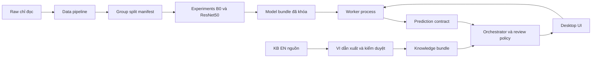

# Kiến trúc desktop — đề xuất chờ duyệt

**Cập nhật Setup 13/10/2026:** tên đã chốt “Ứng dụng thẩm định và nhận diện dịch bệnh cho giống cây cà chua”; phạm vi nhận diện bệnh/trạng thái lá và hướng dẫn trồng/chăm sóc phù hợp, desktop Windows/offline/tiếng Việt, EfficientNet và ResNet50. Không tối ưu canh tác; WUR/Dryad/Mendeley chỉ là tài nguyên nghiên cứu bổ sung. Runtime đã setup; tài liệu vẫn là draft chưa tiếp nhận chính thức, xem [README](README.md) và [setup-report](setup-report.md).

Ngày 13/10/2026. Đầu vào `bmad-architecture`; chưa có architecture spine được workflow finalize. Quyết định AD bên dưới giữ ID để tiếp nhận sau. Không cài dependency, tạo module hay skeleton.

## So sánh stack

| Phương án | Phù hợp | Trade-off trong hai tháng |
| --- | --- | --- |
| Python + PySide6 Widgets + PyTorch CPU | Training/inference cùng ngôn ngữ, desktop native, worker/process, kiểm soát layout/keyboard | Thêm Qt dependency, bundle lớn và kiểm nghĩa vụ LGPL/commercial/third-party |
| Python + Tkinter + PyTorch CPU | Ít tầng hơn, thư viện chuẩn Python có binding Tcl/Tk | Cần công sức hơn cho accessibility/typography/flow phức tạp; vẫn cần đóng gói Tcl/Tk/PyTorch |
| .NET/WPF + runtime inference như ONNX Runtime | Windows native, phù hợp nhóm biết C# | Thêm export/parity/runtime, hai ngôn ngữ và hợp đồng tensor; chưa chứng minh cần cho đồ án |

**AD-1 — đề xuất:** Python + PySide6 Widgets, PyTorch/torchvision cho training và inference ban đầu; PyInstaller onedir cho bundle thử nghiệm. Lý do: giảm chuyển đổi/export và ranh giới ngôn ngữ. Python/std-lib JSON cho knowledge; SQLite chỉ khi history được duyệt. Không thêm Electron/web frontend, web server, vector DB, LLM hoặc dịch runtime. Nguồn stack/license tại [research](research.md). Không coi thư mục frontend hiện có là yêu cầu làm web.

**AD-2 — đề xuất:** EfficientNet-B0 và ResNet50 so sánh, chỉ đóng gói winner đã chọn trên validation. Model không sinh văn bản. Ensemble/ONNX/SVM là nhánh riêng cần bằng chứng và duyệt.

**AD-3 — đề xuất:** đường training riêng với raw chỉ đọc và artifacts dẫn xuất; ứng dụng chỉ mang một model, labels, preprocessing, KB VI/EN cần thiết, lesson và notice. Không mang dataset/training dependencies như notebook/data loader toàn bộ vào gói runtime.

**AD-4 — đề xuất:** một worker process inference chạy ngoài GUI, một job active, không pending queue; CPU thread budget khởi điểm 2, thay đổi bằng benchmark. Process là lựa chọn tối thiểu có lý do cho hủy cứng khi decoder/inference treo; không microservice. Khởi động 1 worker, nạp model một lần, warm-up có log thời gian, không process mới cho từng ảnh.

**AD-5 — đề xuất:** config paths + versioned manifest; không hardcode đường raw local trong logic. Asset app resolve tương đối bundle, user state trong thư mục người dùng, training data root do config. Không cho UI import model/KB tùy ý trong MVP.

**AD-6 — đề xuất:** kho song ngữ dẫn xuất offline; code chuẩn → đúng một record có status/role/scope; bản chưa duyệt bị chặn hoặc giới hạn demo theo policy. Giữ raw ID và correction notes, không sửa raw.

**AD-7 — đề xuất:** history default off; hoãn S20 đến khi core chạy và còn ngân sách. Không thêm persistence ảnh chỉ để demo được nhiều tính năng.

**AD-8 — đề xuất:** first-party architecture allowlist + tensor state dict, restricted loading với weights_only/map CPU phù hợp version được pin; hash/manifest/schema/resource checks. Không load serialized full Python model, dynamic imports hoặc remote code từ artifact không tin cậy. Hash trong bundle phát hiện hỏng nhưng không chống kẻ tấn công thay cả bundle; package signing là nhánh đánh giá sau, không hứa authenticity bằng SHA-256 một mình.

## Module và hướng phụ thuộc dự kiến

Tên là trách nhiệm dự kiến, **không phải thư mục đã tạo**.

| Module | Trách nhiệm và output | Được phụ thuộc vào | Không được làm |
| --- | --- | --- | --- |
| Data pipeline | Inventory, provenance, group/duplicate resolution, split manifest | Raw chỉ đọc, config, labels | Train trước split; sửa raw hoặc fit trên val/test |
| Experiments | Head/fine-tune, validation selection, logs/checkpoints/model card | Manifest, labels, preprocessing, framework | Dùng test chọn config/winner; gọi UI |
| Inference | Validate model, preprocess, forward, policy từ chối | Model manifest, labels, pipeline preprocessing dùng chung | Sinh hướng dẫn hoặc tải weights online |
| Knowledge | Lookup status, review policy, source/context/lesson links | KB manifest, localization dẫn xuất | Gộp top-k thành phác đồ; suy context từ ảnh |
| Localization | Mapping tên VI, glossary, EN/VI revisions | Labels/KB source IDs | Đổi raw ID/ảnh; dịch runtime mặc định |
| UI/orchestration | Chọn ảnh, worker lifecycle, status, render nguồn/bài học | Contracts inference/knowledge, config | Train, giải mã nặng hoặc forward trên GUI thread |
| Persistence (tùy chọn) | Preferences/history opt-in, delete/export an toàn | Std-lib local storage | Đọc raw training; upload hoặc tự copy ảnh |

Ảnh người dùng → worker là trust boundary; package model/KB → loader là boundary thứ hai; UI → filesystem history/preferences là boundary nếu S20 được duyệt. Có bảng threat đầy đủ trong security-testing.

## Contract dữ liệu ở mức thiết kế

Không là code/schema implementation. Khi triển khai sẽ thống nhất kiểu và validator trong S06, không duplicate class dictionaries ở UI/training.

| Contract | Field bắt buộc / ý nghĩa | Invariant |
| --- | --- | --- |
| Label manifest | schema_version, ordered 10 status_code, raw label, vi_name, issue_kind, knowledge_id, mapping_version | 10 mã duy nhất; index cố định; không là thứ tự scan thư mục |
| Dataset manifest | relative_path, source/revision/hash, raw_label, status_code, leaf_group_id, duplicate_component_id, split, inclusion_reason | Raw không đổi; group/duplicate component không qua split; ảnh không rõ nhóm bị quarantine |
| Model manifest | model_id/version, architecture/variant, weights enum/URL/hash/license status, framework versions, checkpoint hash, class_order, preprocessing_version, split hash, selection_record, policy_version | Checkpoint đúng labels/transform; no silent fallback; license chưa rõ chặn phân phối |
| Prediction request | request_id, image local reference, image identity/hash, requested model_version, cancellation token/control | Một ảnh/job; limits trước tensor; request_id không tái dùng |
| Prediction result | request_id/image_identity, status, status_code hoặc null, score_vector nội bộ, decision_reason, model/preprocess/policy versions, elapsed fields | status ∈ accepted/uncertain/out_of_scope/invalid/cancelled/error; non-accepted không dùng nhãn để tư vấn |
| Knowledge record | status_code, raw disease_id, source EN revision, VI revision, source claims/locator, symptoms/care/prevention/cautions, context_conditions, review_actor/role/status/scope/date, lesson_ids | Tách technical review/source_checked/expert_approved; không nguồn thì suppress claim |
| Application result | prediction + record/status knowledge + display limits + lesson | Inference thành công không có nghĩa knowledge approved; stale request không render |
| History nếu có | history_id, time, model/KB versions, result status/code, opt-in metadata | Không lưu score thành bệnh xác nhận; ảnh/path/EXIF không mặc định lưu |

Tất cả runtime contracts cần schema_version. Release manifest gắn app version, model version, class mapping version, preprocessing version, knowledge/localization/lesson versions; lệch class order hoặc unsupported schema = fail closed. Update offline tương lai là whole bundle kiểm tương thích, không có tính năng import archive/model tự do trong MVP.

## Giới hạn và lifecycle dự kiến

Ảnh cho phép JPEG/PNG theo magic/decode, kể cả đuôi viết hoa; RGB/EXIF orientation chuẩn hóa vào bản xử lý, giữ file gốc. Đề xuất limits: 20 MiB/file, 24 megapixel, cạnh dài ≤12.000 px, cạnh ngắn ≥64 px; các giới hạn phải thử trong S14, không suy từ KB min_resolution. Chất lượng mờ dùng threshold validation, không gọi mọi ảnh 256 px là lỗi.

GUI chọn file → kiểm tra nhẹ → worker bounded decode/preprocess/infer → prediction → knowledge policy → render. Disable chạy khi job active. Cancel/đổi ảnh đánh dấu request vô hiệu; cooperative cancel giữa các bước, nếu job không dừng sau grace đề xuất 2 giây thì terminate/restart worker. Watchdog đề xuất 15 giây cho job; phân biệt cold load/timeout trong log, cần benchmark. Process end có cleanup, không kill process ngoài app. Crash worker không làm mất ảnh gốc; UI hướng dẫn retry.

Không bắt GPU ở máy đích; build/runtime CPU first, GPU training chỉ ở môi trường nghiên cứu. Giữ máy có thể dùng đồng thời cho UI; không chiếm vô hạn CPU/RAM. Nếu một forward native không thể hủy cooperative, process boundary thực hiện hủy và bỏ kết quả.

## Gói offline và quyết định phải thử

Gói đề xuất onedir gồm app, Qt plugins/DLL cần thiết, Python/PyTorch runtime CPU, first-party state dict, manifest, KB VI/EN, lessons, notices. Không pretrained download lúc boot; khởi tạo architecture không tự fetch, load artifact đã đóng gói. Training environment và runtime bundle có dependency set riêng.

S18 thử máy Windows sạch không Python/CUDA, path có dấu/khoảng trắng, tài khoản thường, mạng tắt, reconnect không phát sinh upload. Kiểm antivirus, startup/RAM/size, license notices và cleanup uninstall chỉ trong thư mục app/user state được chọn. Chưa chọn installer/signing hoặc version cụ thể trước packaging spike. Nếu stack đổi vì bằng chứng, cập nhật AD-1/contract/ước lượng và duyệt trước implementation.
